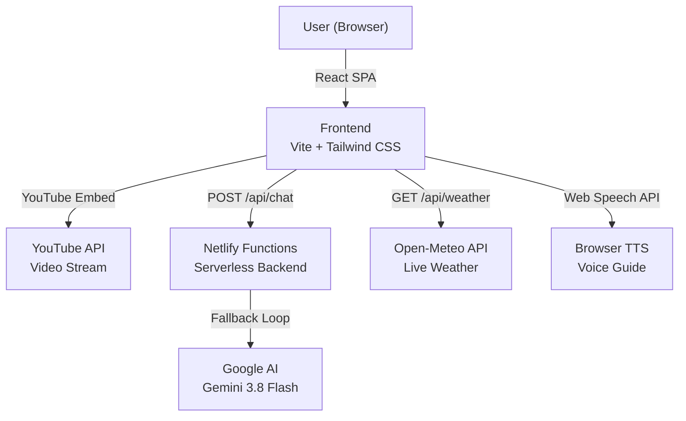

# 🌍 Earth Jukebox — NASA Data Sonification

**Turning Climate Data into Music for Blind and Low-Vision Users**

Earth Jukebox is an interactive, accessible web platform that translates NASA's Earth observation data into immersive music. By mapping specific colors from satellite visualizations to musical instruments, we make complex climate data accessible to blind, visually impaired, and auditory learners.

### ⚡ Tech Stack


| Parameter | Value |
|---|---|
| **Challenge** | The Earth Information Jukebox (NASA Space Apps Challenge 2026) |
| **Team** | MindWave |
| **Version** | `1.0.0` |
| **Live Demo** | [earth-jukebox.netlify.app](https://earth-jukebox.netlify.app) |
| **Repository** | [winlu2303/earth-jukebox](https://github.com/winlu2303/earth-jukebox) |
| **Status** | MVP (Ready for Demo) |

---

## 📖 Table of Contents

1. [Solution Purpose](#1-solution-purpose)
2. [Main User Scenario](#2-main-user-scenario)
3. [Core Features (What We Built)](#3-core-features-what-we-built)
4. [Architecture & Components](#4-architecture--components)
5. [Running Locally](#5-running-locally)
6. [Environment Variables](#6-environment-variables)
7. [External Services & Integrations](#7-external-services--integrations)
8. [Data Processing & Sonification Pipeline](#8-data-processing--sonification-pipeline)
9. [Step-by-Step Testing Scenario](#9-step-by-step-testing-scenario)
10. [Known Limitations](#10-known-limitations)
11. [Scalability (5-Year Plan)](#11-scalability-5-year-plan)
12. [Custom API](#12-custom-api)
13. [Security & Data Privacy](#13-security--data-privacy)

---

## 1. Solution Purpose

Climate change data from NASA is typically presented as complex heatmaps, graphs, and visualizations. For the 300+ million blind and low-vision people worldwide, this crucial information is completely inaccessible.

**Earth Jukebox** bridges this gap. We convert the colors of NASA's satellite imagery into distinct musical instruments:
- 🔴 **Red** → Bass
- 🟠 **Orange** → Piano
- 🟡 **Yellow** → Strings
- 🟢 **Green** → Flute
- 🔵 **Blue** → Cello
- 🟣 **Purple** → Synth
- ⚪ **White** → Bells

By listening to the music, users can "hear" the urgency of climate change. A heavy, suffocating bass means high pollution. A chaotic clash of instruments means extreme weather.

---

## 2. Main User Scenario

### As-Is (Current Problem)
- A blind student cannot interpret a NASA heatmap of CO2 concentrations.
- A visually impaired researcher cannot quickly analyze color-coded anomalies.

### To-Be (Our Solution)
1. The user opens Earth Jukebox.
2. Clicks the **"🔊 Audio Guide"** button to hear how the site works.
3. Selects a dataset (e.g., Carbon Monoxide).
4. The **Spirit of Earth** (an animated pixel character) tells people what they are about to hear.
5. The user plays the sonified video and hears the data.
6. They can use the **Instrument Mixer** to isolate specific colors (e.g., mute the bass to hear only the piano).
7. They can ask the **AI Chatbot** questions about the climate data.

---

## 3. Core Features (What We Built)

We have implemented 15+ distinct features, categorized by purpose.

### 🎨 Visual & Sonification
| Feature | Description |
|---|---|
| **Sonified Videos** | NASA videos mapped to 7 instruments using Python (OpenCV) and FluidSynth. Hosted on YouTube for lightweight deployment. |
| **Live Color Analysis** | A real-time canvas analyzer (`useColorAnalysis.js`) that displays the percentage of each color in the current frame. |
| **Instrument Isolation** | A mixer that allows users to mute/unmute specific instruments (Bass, Piano, Strings, etc.) to understand individual data layers. |
| **Interactive World Map** | Clickable regions (Amazon, Sahara, Siberia, Arctic) that play localized soundscapes. |
| **City Sonification** | Real-time weather data from Open-Meteo is converted into music (e.g., "Moscow today sounds like a cold cello"). |

### ♿ Accessibility (Core Theme)
| Feature | Description |
|---|---|
| **Screen Reader Support** | Full ARIA labels, `aria-live` regions, and semantic HTML for blind users. |
| **Audio Guide** | A button that uses the Web Speech API to explain the entire site navigation. |
| **Voice Feedback** | When a dataset is selected, the system announces: "Now playing: Carbon Monoxide. You will hear Bass, Piano, and Strings." |
| **Tactile Feedback** | Haptic vibration responses on mobile devices for every major button press. |
| **The Spirit of Earth** | An animated pixel-art character that follows the mouse and comments on datasets (with voice synthesis). |

### 🤖 AI & Education
| Feature | Description |
|---|---|
| **Ask the Earth (AI Chatbot)** | Powered by Gemini API. Users can ask questions about climate data, and the AI responds in the persona of the Spirit of Earth. Includes a fallback system (3 models) for stability. |
| **Guess the Instrument Game** | A mini-game where a random instrument plays for 3 seconds, and the user guesses which color/instrument it is. |
| **Story Mode** | A scroll-based narrative (Framer Motion) telling the story of a blind girl named Mia who "hears" climate change for the first time. |
| **Rich Descriptions** | Each dataset includes a short and long description, explaining not just the sound, but the environmental impact. |

---

## 4. Architecture & Components



---

## 5. Running Locally

```bash
# Clone the repository
git clone https://github.com/winlu2303/earth-jukebox.git
cd earth-jukebox

# Install dependencies
npm install

# Start development server
npm run dev
```

---

## 6. Environment Variables

Create a `.env` file in the root directory to store your API keys securely. This file should **never** be committed to GitHub (it's already included in `.gitignore`).

```dotenv
GEMINI_API_KEY=<your_key_from_Google_AI_Studio>
```

---

## 7. External Services & Integrations

Our application relies on several external services, some of which are free and others require API keys. Below is a detailed breakdown of how each service is integrated and what happens if it fails.

| Service | Purpose | Integration Method | Failure Fallback |
|---|---|---|---|
| **YouTube API** | Hosting of sonified video content. | `iframe` embed with `youtube.com/embed/{id}`. | If the video is unavailable, the user sees a blank player. We recommend having a local copy for the demo. |
| **Gemini API** | AI chatbot responses ("Ask the Earth"). | POST request to `generativelanguage.googleapis.com`. | Implemented a fallback loop across 3 models: `gemini-3.8-flash`, `gemini-2.5-flash`, and `gemini-3.1-flash-lite-preview`. |
| **Open-Meteo API** | Live weather data for "City Sonification". | GET request to `api.open-meteo.com/v1/forecast`. | If the API is down, the user receives a "Could not fetch weather data" message. |
| **Netlify Functions** | Serverless backend for the chatbot. | Deployed as a Node.js serverless function at `/.netlify/functions/chat`. | If the function crashes, the frontend catches the error and displays "Error connecting to the server". |
| **NASA SVS / GMAO** | Source of raw satellite data. | Downloaded manually and processed with Python. | The app uses pre-processed videos, so it is not dependent on the live NASA API. |

---

## 8. Data Processing & Sonification Pipeline

The core of the project is the transformation of visual data (colors) into audio data (musical notes). This process is done offline using Python and then delivered to the frontend.

### 8.1 Step-by-Step Pipeline

1. **Frame Extraction:**
   - Python script: `analyze_all_videos.py`
   - Uses OpenCV to extract frames from the NASA GMAO video at 12 FPS.

2. **Color Analysis:**
   - Each frame is analyzed pixel by pixel.
   - Pixels are clustered into 7 categories: Red, Orange, Yellow, Green, Blue, Purple, White.
   - The percentage of each color is calculated.

3. **Musical Mapping:**
   - Colors are mapped to MIDI instruments:
     - Red → Bass (Program 32)
     - Orange → Piano (Program 0)
     - Yellow → Strings (Program 48)
     - Green → Flute (Program 73)
     - Blue → Cello (Program 42)
     - Purple → Synth (Program 81)
     - White → Bells (Program 14)
   - The `music21` library is used to generate a MIDI file with 7 tracks.

4. **Audio Rendering:**
   - FluidSynth is used to render the MIDI file into a WAV file.
   - The GeneralUser GS SoundFont (31 MB) is used for realistic instrument sounds.

5. **Synchronization:**
   - FFmpeg merges the original video with the generated audio.
   - The final output is an MP4 file (`co_final.mp4`, etc.).

6. **Deployment:**
   - The final videos are uploaded to YouTube (Unlisted).
   - The frontend accesses them via the YouTube Embed API.

### 8.2 Frontend Real-Time Analysis

In the browser, we also have a real-time color analysis feature (for local videos only, due to CORS).

- **File:** `src/hooks/useColorAnalysis.js`
- **Technology:** Canvas API (`getImageData`).
- **Mechanism:** Every frame, the video is drawn to a hidden canvas, and the pixels are read. The colors are quantized using a nearest-neighbor algorithm.
- **Output:** The `ColorChart.jsx` component displays the percentages dynamically.

---

## 9. Step-by-Step Testing Scenario

We have prepared a detailed checklist for the jury to verify every feature of the application.

| Step | Action | Expected Result | Component Tested |
|---|---|---|---|
| 1 | Open the website. | Starry background, gradient title, and dataset buttons are visible. | `App.jsx` |
| 2 | Click the **"🔊 Audio Guide"** button. | The browser speaks: "Welcome to Earth Jukebox..." | `AccessibilityProvider.jsx` |
| 3 | Select the **"Carbon Monoxide"** dataset. | The YouTube video loads, and the voice says: "Now playing: Carbon Monoxide..." | `DatasetButton.jsx`, `SpiritOfEarth.jsx` |
| 4 | Press Play on the video. | The video plays. The color chart below updates (if the video is local). | `VideoPlayer.jsx` |
| 5 | Click on the **"Instrument Mixer"** buttons. | The buttons toggle between "On" and "Muted" (visual state). | `InstrumentMixer.jsx` |
| 6 | Switch to the **"Live NASA Data"** tab. | The `LiveMap` component tries to load NASA GIBS tiles. (May fail due to regional restrictions). | `LiveMap.jsx` |
| 7 | Scroll down to the **"Ask the Earth"** chat. | | `ChatBot.jsx` |
| 8 | Type: "How does the Amazon sound?" and press Enter. | The AI responds in the persona of the Spirit of Earth. | Netlify Function + Gemini API |
| 9 | Go to the **"City Sonification"** section. | | `LiveCitySound.jsx` |
| 10 | Enter "Moscow" and click "Hear it". | The bot reports the temperature and says: "Moscow is 5°C today. It sounds like Piano." | Open-Meteo API |
| 11 | Go to the **"Guess the Instrument"** game. | | `GuessGame.jsx` |
| 12 | Click "Play Sound" and guess the instrument. | The score increases if you guess correctly. | Audio playback |
| 13 | Click on the **"Interactive Earth"** map. | | `WorldMap.jsx` |
| 14 | Click on the "Amazon" region. | A sound plays, and the voice says: "You selected the Amazon..." | `WorldMap.jsx` |
| 15 | Click the **"🌍 Story Mode"** button in the header. | | `StoryMode.jsx` |
| 16 | Scroll down to read the story of Mia. | The text fades in as you scroll. | Framer Motion |
| 17 | Press the **"🔊 Voice ON/OFF"** toggle. | The voice guide is disabled/enabled. | `useSpeech.js` |

---

## 10. Known Limitations

We want to be transparent about the current limitations of our MVP.

1. **No Real-Time Analysis for YouTube Videos:**
   - Due to CORS (Cross-Origin Resource Sharing) restrictions, the browser cannot read pixels from a YouTube iframe.
   - **Impact:** The live color chart only works for locally hosted videos. For the deployed version, we use static color percentages.

2. **Gemini API Rate Limits:**
   - On the free tier, Google may return a `503 Service Unavailable` error during high demand.
   - **Mitigation:** We implemented a fallback loop across 3 different models. If one fails, the system automatically tries the next one.

3. **NASA GIBS WMS Tiles:**
   - The `LiveMap` component uses NASA GIBS tiles, which are sometimes blocked by regional firewalls or slow to load.
   - **Impact:** The "Live NASA Data" tab may show a blank map. The "Sonified Video" tab is the primary, stable feature.

4. **Web Speech API Inconsistencies:**
   - The voice synthesis depends on the user's operating system. Some browsers (e.g., Safari on macOS) may have robotic-sounding voices.
   - **Impact:** The quality of the voice guide may vary.

5. **Haptics on Desktop:**
   - The vibration API (`navigator.vibrate`) only works on mobile devices. On desktop, it is silently ignored.

---

## 11. Scalability (5-Year Plan)

Our vision extends far beyond a hackathon prototype. Here is how Earth Jukebox will evolve over the next 5 years to impact society and science.

### Year 1: Foundation & Accessibility Expansion
- **Action:** Integrate the entire NASA GMAO dataset library. Add support for tactile braille displays.
- **Impact:** Make daily climate data accessible to over 300 million visually impaired people worldwide.

### Year 2: Real-Time Global Sonification
- **Action:** Transition from pre-rendered videos to live Web Audio API synthesis. Users can listen to real-time global weather changes.
- **Impact:** Allow scientists to "listen" to anomalies in real-time, potentially discovering patterns that visual analysis misses.

### Year 3: AI-Driven Adaptive Soundscapes
- **Action:** Implement machine learning models that adapt the music based on the severity of the data (e.g., extreme pollution triggers dissonant chords).
- **Impact:** Create a universal emotional language for climate change, bypassing linguistic and cultural barriers.

### Year 4: Educational Integration
- **Action:** Launch a dedicated educational portal and API for schools. Partner with blind education institutions.
- **Impact:** Introduce climate science into special education curricula globally, fostering a new generation of blind scientists.

### Year 5: Open-Source Standard for Sonification
- **Action:** Release the entire sonification pipeline as an open-source standard for other scientific fields (e.g., astronomy, medical imaging).
- **Impact:** Establish "sonification" as a standard tool in scientific research, revolutionizing how data is interpreted by all human senses.

---

## 12. Custom API

Our backend is implemented as a Serverless Function on Netlify. It acts as a secure proxy between the frontend and the Google Gemini API, ensuring the API key is never exposed to the client.

### Base URL
- **Production:** https://earth-jukebox.netlify.app/.netlify/functions

### Endpoints

**POST /chat**

Sends a user message to the AI and returns the generated response.

**Request Headers**

```http
Content-Type: application/json
```

**Request Body**

```json
{
  "message": "How does the Amazon sound today?"
}
```

**Response (200 OK)**

```json
{
  "reply": "The Amazon sounds like a deep bass rumble with occasional piano chords. The redder the map, the louder the bass."
}
```

**Error Responses**
- **405**: Method Not Allowed (The request was not a POST request.)
- **500**: API key is missing in environment variables (GEMINI_API_KEY is not set in Netlify.)
- **500**: All models failed (Google API is down or the key is invalid/rate-limited (503/404).)
- **500**: Internal Server Error (A syntax error or unexpected runtime exception in the function.)

### Rate Limits

Because we use the free tier of the Gemini API, the endpoint is subject to Google's rate limits. In case of a 503 Service Unavailable error, the backend automatically retries with the following fallback models in order: gemini-3.8-flash; gemini-2.5-flash; gemini-3.1-flash-lite-preview. 

---

## 13. Security & Data Privacy

We take the security of our users and our API keys seriously.

1. **API Key Protection:** The GEMINI_API_KEY is stored securely in Netlify's Environment Variables. It is never committed to the GitHub repository. The .env file is explicitly ignored in .gitignore.
2. **CORS Policy:** The Netlify Function handles requests from the frontend. Cross-Origin Resource Sharing is restricted to our domain.
3. **No User Data Collection:** The chatbot does not save conversation history to a database. Each message is processed statelessly and immediately discarded.
4. **YouTube Embeds:** The videos are hosted on YouTube. We use the standard privacy-enhanced mode (youtube-nocookie.com) to minimize tracking.

---

We are open to feedback, collaboration, and scaling this project to new heights. Thank you to the NASA Space Apps Challenge organizers for the opportunity to make science accessible to everyone.